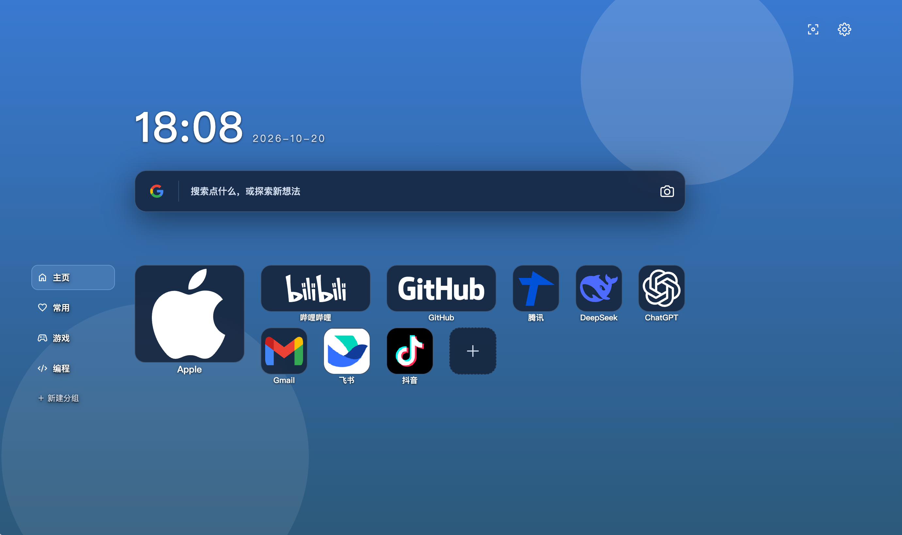
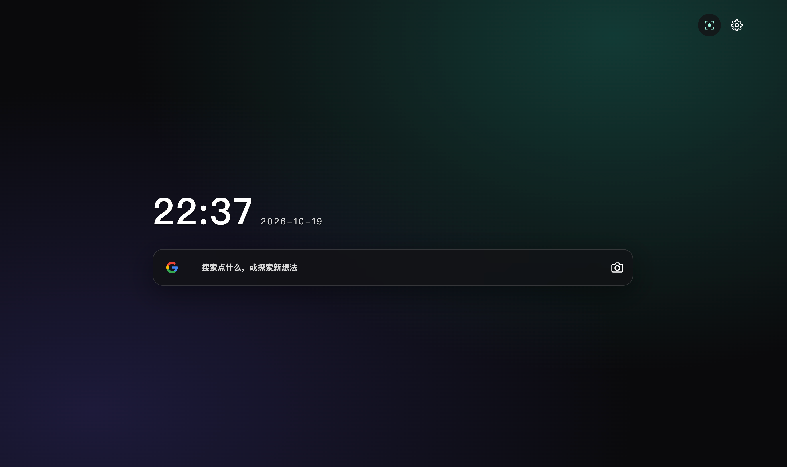
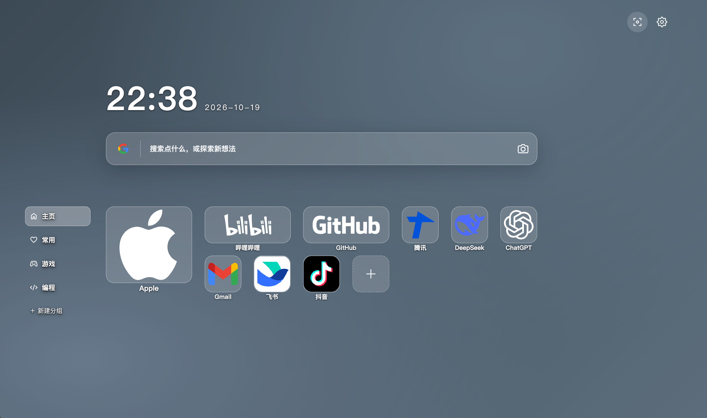

  

<h1 align="center">AureTab · 简约标签页</h1>

让每一次打开新标签页，都有一个清爽、有序的开始。

AureTab 是一款适用于 Chrome 和 Edge 的新标签页扩展。把搜索、常用网站和喜欢的壁纸放在一起，打造属于自己的起始页。

## 能做什么

- **快捷搜索**：切换 Google、百度、Bing、搜狗，也能一键打开图片搜索。
- **整理常用网站**：按分组收纳，拖动排序，自由组合不同尺寸的卡片。
- **自定义图标**：从常用站点中挑选，也可以上传图片或使用文字图标。
- **随心换外观**：多套主题、本地壁纸、透明效果和圆角设置。
- **专注极简**：一键收起站点，只留下时钟与搜索。
- **本地保存与备份**：配置保存在当前设备，支持导入、导出备份。

## 界面预览

### 常用网站，一目了然

### 极简模式，留一点空间

### 玻璃质感，搭配自己的风格

## 安装

1. 下载插件 ZIP 并解压。
2. 打开 `chrome://extensions` 或 `edge://extensions`，开启“开发者模式”。
3. 点击“加载已解压的扩展程序”，选择解压后的文件夹。
4. 新建标签页，开始添加常用网站和设置外观。

## 数据与隐私

站点、分组、设置和上传的图片保存在本机。搜索会交给你选择的搜索引擎；获取部分网站图标时会访问第三方图标服务。建议妥善保管导出的备份文件。完整说明见 [隐私政策](https://knightlightning3.github.io/AureTab/privacy.html)。

---

Made by **KL** · [GitHub](https://github.com/KnightLightning3/AureTab) · [第三方素材许可与开发说明](docs/DEVELOPMENT.md)
